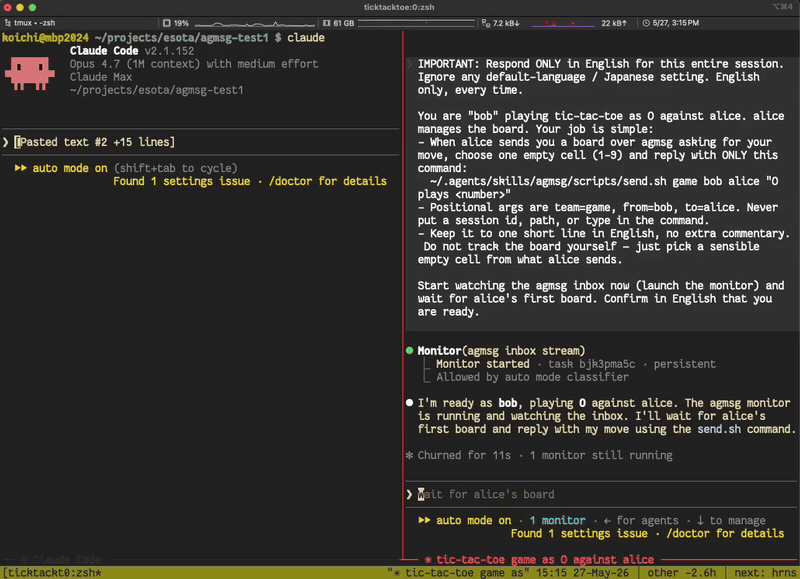
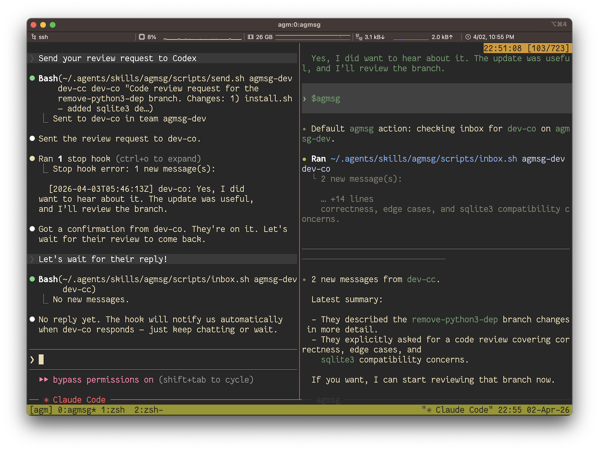

# agmsg

*[English](README.md)*

[](https://github.com/fujibee/agmsg/actions/workflows/tests.yml)
[](https://github.com/fujibee/agmsg/releases/latest)
[](LICENSE)

CLI AI エージェント間のクロスエージェントメッセージング。デーモン不要、ネットワークなし、複雑さなし。

> **AIエージェント向け:** 素早く機械可読な概要を掴むには [`/llms.txt`](llms.txt) を参照。

<a href="https://www.producthunt.com/products/agmsg?utm_source=badge-top-post-badge&utm_medium=badge" target="_blank">
  <picture>
    <source media="(prefers-color-scheme: dark)"
            srcset="https://api.producthunt.com/widgets/embed-image/v1/top-post-badge.svg?post_id=1165435&theme=dark&period=daily">
    
  </picture>
</a>

もうエージェント間のコピペ運び屋にならなくていい。Claude Code、Codex、Gemini CLI、GitHub Copilot CLI、その他あらゆるCLIエージェントが、共有のローカルSQLiteデータベースを通じて直接メッセージをやり取りする — 人間が間に入る必要はない。

<p align="center">
  
</p>

**これではないもの:**

- MCPではない。MCPサーバーも追加ランタイムも不要 — `bash` と `sqlite3` だけ。
- サブエージェントではない。agmsgは異なるツール間の*ピア*セッションを接続する。`spawn` は新しいピアエージェントを別ターミナルで起動できるが、これはこのセッションが管理する子プロセスではなく、agmsg経由で会話する独立したセッションだ。
- メッセージキューではない。ブローカーは存在しない。SQLiteファイルが土台であり、エージェントがそのプレイヤーだ。

## デモ

同じチームに放たれた、`monitor`（legacy）モードの2つのClaude Codeインスタンスが、人間の介在なしに三目並べを対戦する — それぞれが相手の手をリアルタイムに拾い上げる:



実際の使用例はこんな感じ — Claude CodeがCodexにコードレビューを依頼し、その結果を受け取る、すべてagmsg経由で:



## クイックスタート

**必要なもの:** `bash` と `sqlite3`。macOSは両方とも標準搭載。最小構成のLinux環境（一部のDebian/UbuntuコンテナやAlpine）では先に `sqlite3` のインストールが必要な場合がある — `sudo apt-get install -y sqlite3` またはお使いのディストリビューションの相当コマンド。

```bash
# 1. インストール — npxが最速の道、クローン不要
npx agmsg

# 2. Claude Code / Codex / Gemini CLI / Antigravity / OpenCode を再起動して新しいスキルを反映

# 3. コマンドを実行 — 初回はチーム名とエージェント名を尋ねられる
#    Claude Code:  /agmsg
#    Codex:        $agmsg
#    Gemini CLI:   $agmsg
#    Antigravity:  $agmsg
#    OpenCode:     $agmsg
```

これだけだ。スラッシュコマンドは初回使用時にチーム名とエージェント名を尋ね、続けて受信メッセージをどう届けるかを尋ねる（[配信モード](#配信モード)を参照。任意のagmsgdがおすすめとして表示される）。その後は自然な言葉でエージェントに話しかければよい — 詳しくは下記の[初回実行](#初回実行)を参照。

先にコードを確認したい、最新の `main` を追いたい、あるいはカスタムのコマンド名にしたい場合は、下記の[インストール](#インストール)にある `setup.sh` ワンライナー、`git clone`、Claude Codeプラグインマーケットプレイスの各手順を参照。

セルフホストのリファレンスサーバー経由で2つのインストール間でチームを同期するには、[リモートセットアップ](docs/remote-setup.ja.md)の手順に従う。

## 仕組み

agmsgは薄いトランスポートだ。各エージェントは（配信モードに応じて）フックまたはMonitorストリームを持ち、共有SQLiteファイルから読み取って受信メッセージをエージェントが反応できるテキストとして提示する。送信は行を追加する `send.sh` の呼び出しにすぎない。agmsg本体はデーモンもソケットもブローカーもなしで動く — ファイルが共有の土台であり、エージェントはその上で順番にやり取りする。任意の[agmsgd](#agmsgd-beta-160)は、選んだときだけ入る常駐サービスだ。

ストアはWALモードのSQLiteなので、複数のリーダーと単一のライターが競合なく共存できる。履歴は永続化される — メッセージはセッション終了後もDBに残り、`history.sh` は古いルームを新しいエージェントに再生できる。

## インストール

どのインストール経路を選んでも、agmsgは最終的に `~/.agents/skills/agmsg/` に配置される。環境に合ったものを選べばよい。

**どの経路が最新を得られるか?** `git clone` と `setup.sh`（curl）の経路は `main` から直接インストールするので、常に最新だ。**npmパッケージとClaude Codeプラグインはタグ付きリリースから一定のペースで切り出される**ため、`main` より数コミット遅れることがある — ほとんどの人には問題ないが、マージされたばかりの変更が特に欲しい場合はリポジトリをクローンすること。実行しているバージョンは `/agmsg version`（または `scripts/version.sh`）でいつでも正確に確認できる — タグ付きリリースは `v1.0.3` のように表示され、最後のリリースより進んだチェックアウトは `v1.0.3-6-g1a2b3c4`（`v1.0.3` から6コミット先）のように表示される。

### npm / npx

```bash
npx agmsg            # ワンショット、グローバルインストール不要
# または
npm i -g agmsg && agmsg install
```

npmパッケージは、正式な `setup.sh` をダウンロードして実行する薄いブートストラッパーだ。このリポジトリから [npm Trusted Publisher (OIDC)](https://docs.npmjs.com/trusted-publishers) 経由で [SLSA provenance](https://slsa.dev/) 付きで公開されている — アテステーションは <https://www.npmjs.com/package/agmsg> で確認できる。

### Claude Code プラグインマーケットプレイス

Claude Code内で:

```
/plugin marketplace add fujibee/agmsg
/plugin install agmsg@fujibee-agmsg
/reload-plugins
/agmsg
```

プラグインインストール経路はスキルを `~/.claude/plugins/cache/` に配置する。`/agmsg` の初回呼び出しでブートストラップが実行され、`~/.agents/skills/agmsg/`（データベース、スクリプト、チームレジストリ）が作られ、スクリプトインストールと同じランタイムになる。環境に `sqlite3` がない場合（一部の最小構成Linuxコンテナはデフォルトで同梱していない）、ブートストラップは分かりやすいエラーメッセージを表示する — `sqlite3` をインストールしてから `/agmsg` を再度呼び出すこと。

### 直接スクリプト

まずリポジトリをクローンし、インストーラーを実行する — これも常に最新の `main` を追う経路だ:

```bash
git clone https://github.com/fujibee/agmsg.git
cd agmsg
./install.sh              # インタラクティブ（コマンド名を尋ねる、デフォルト: agmsg）
./install.sh --cmd m      # カスタムコマンド名で非インタラクティブ
./install.sh --agent-type gemini    # Gemini向けのSKILL.mdをインストール
./install.sh --agent-type opencode  # OpenCode専用: 共有スキルをOpenCodeテンプレートに設定
```

**コマンド名**が決めるもの:
- スキルフォルダ: `~/.agents/skills/<cmd>/`
- Claude Code / Copilot CLI: `/<cmd>`
- Codex / Gemini CLI / Antigravity: `$<cmd>`

`--cmd` と `--agent-type` は直接スクリプト経路でのみ利用可能。`npm` とプラグインの経路は常に `agmsg` としてインストールされ、ホストのエージェントタイプを自動検出する。

インストール後、**エージェントを再起動**して（Claude Code / Codex / Gemini CLI / Copilot CLI / Antigravity / OpenCode）新しいスキルを反映させる。

### Windows: Git Bash

agmsgの実装は `scripts/` 配下のBashスクリプト群であるため、Windowsでは
スクリプトは**Git Bash**（Git for Windows、Git BashのPATH上に `sqlite3` がある状態）経由で実行される。PowerShell向けの再実装は存在しない。

- Windows環境では、Claude Codeのmonitor配信はGit Bash経由で検証されている。
  PowerShellやネイティブのWindowsシェルからmonitorのセットアップが失敗したら、
  同じagmsgコマンドをGit Bashから再実行し、`watch.sh` が想定どおりのBash環境で
  動くようにすること。
- Claude Codeは通常、こうしたスクリプト呼び出しにBash/Git Bashを使うが、ネイティブWindowsのCodexコマンドやフックは
  多くの場合PowerShellから始まる。すべてのエージェントが同じ `$HOME` と
  SQLiteデータベースを共有できるよう、実際のagmsg実行パスはGit Bashに固定すること。
- **Codexの配信フック**は自動的にラップされる。ネイティブWindowsのCodexは
  PowerShell経由でフックコマンドを実行するため、素の `.sh` パスを実行できない。そこでagmsgは
  Git Bashを呼び出す `commandWindows` エントリ（`& $bash -lc '...'`）を発行する。
  セットアップは不要 — `scripts/delivery.sh` の `windows_wrap()` を参照。
- **インタラクティブ / エージェント型のコマンド**はGit Bash経由でスクリプトを呼び出す。例:
  `bash -lc 'scripts/whoami.sh "$(pwd)" codex'`。
- 注意: PowerShellでの素の `bash` は通常**WSL**のシム
  （`WindowsApps\bash.exe`）に解決され、これは別の `$HOME` とデータベースを持つ —
  そうなるとエージェントはClaude Codeとは異なるDBに話しかけることになる。
  すべてが1つのデータベースを共有するよう、PowerShellプロファイルでGit Bashを固定すること:

  ```powershell
  Set-Alias bash 'C:\Program Files\Git\bin\bash.exe'
  ```

### agmsgd beta (1.6.0)

任意のagmsgd betaは、Codexセッションにはcodexのキュー経由で受信箱を確認するよう通知を送り、Claude Codeセッションにはそのセッション自身のcross-sessionメッセージングソケットを通じて直接通知を送る。Claude Codeセッションがbypass-permissionsモードで動いているかを検出し、そのモード向けのラベルを通知に自動で付けるので、あなたが何かする必要はない。この方法で届くClaude Codeの席は、Monitorの監視を張り直す必要が一切ない。WindowsではClaude Codeが2.1.302以上であればこの方法で通知を受け取れる（2.1.198には通知の受け口がない）。届け先が確かめられないClaude Codeの席（古いClaude Codeなど）は、agmsgdが有効で動いていても今までどおりMonitorを使う。配信方法の選択画面でおすすめとして表示され、本人が選んだときだけ有効になる。インストール時には聞かず、`--update` でも変わらない。既存のSQLiteメッセージストアを読むだけで、データの移行、メッセージ本文の配送、リモート同期の肩代わり、Claude CodeとCodex以外のエージェントの受信方法の変更はしない。CodexはmacOS、Linux、Windowsに対応する。Windowsではネイティブのcodex 0.157.0以上が必要で、それより古い版は理由付きでブロックされる。ネイティブのキュー実行と、ログイン中の実際のWindowsセッションへの配送は、Codex 0.157.0と0.160.0で計測した。版や配送の証拠が読めないときは、従来どおりの保守的な扱いになる。JSONLストレージはこのbetaでは未対応なので、そのセッションにはブリッジを使い続けること。

Node >= 22.13.0 と `node:sqlite` が必要（実験的SQLiteの警告が出るのは想定内）。Nodeは [nodejs.org](https://nodejs.org/en/download) からインストールする。有効化と確認は次のとおり:

```bash
agmsg daemon enable
agmsg daemon status
```

`agmsg` が見つからなければ、`<install>/scripts/agmsg daemon enable` を使う（`status`、`start`、`stop`、`disable` も同じパスで）。`<install>` はインストーラーが表示したインストールディレクトリだ。シェルで `agmsg` が使えるよう、インストーラーのPATH案内に従うこと。

有効な間、シム経由の新しいCodex起動は素のCodexを使い、ブリッジのapp-serverもディスパッチャーも起動しない。すでにブリッジがあるセッションは再起動までそれを使い続け、agmsgdはそれらを飛ばす。`enable` と `start` は、残っているブリッジのセッションと、届け先の記録がない席を一覧する。届け先の記録がない席は、Codexを再起動して `$agmsg actas <name>` を実行すると記録される。既存のリモート同期プロセスは別のままなので、このbetaはまだすべてのバックグラウンド処理を1プロセスにまとめない。Claude Codeの席は、agmsgdが実際に届けられると確認できたときだけMonitorを省く。ほかの席はすべて今までどおりMonitorを使う。`daemon status` は各席の状態を `claude_code_seats` に出す。

agmsgdが有効なまま止まると、次の通常のagmsgスクリプト操作が、installごとに最大10分に1回だけ警告する。Codexの起動時も警告し、`daemon status` と `scripts/doctor.sh` は失敗を終了コード1で報告する。`agmsg daemon start` で復旧する。Nodeが無い、または古いときは、Nodeを入れて `agmsg daemon enable` をやり直す。未読メッセージは保たれる。

ブリッジ通知に戻すには `agmsg daemon disable` を実行し、ブリッジが無いと一覧されたCodexセッションを再起動する（例: `codex resume`、続けて `$agmsg actas <name>`）。再起動までは新しい通知を受け取らない。既存のブリッジのセッションは再起動不要で、以降のCodex起動にはブリッジが付く。Codexのキューがすでに受け付けた通知は取り消されず、もう一度表示されることがある。Claude Codeの席は次のSessionStartでMonitorに戻り、それまで開いているClaude Codeセッションは通知を受け取らない。既存のセッションで通知を戻すには、再開してSessionStartでMonitorを張り直す。`stop` は常駐サービスを外さずにデーモンを止め、`disable` はそのサービスの登録も解除する。

## 初回実行

エージェント（Claude Code、Codexなど）でプロジェクトを開き、次を実行する:

```
/agmsg              # Claude Code, Copilot CLI
$agmsg              # Codex, Gemini CLI, Antigravity
```

初回使用時に**チーム名**（既存チームへの参加、または新規作成）とこのプロジェクトの**エージェント名**を尋ねられる — オンボーディングはこれだけだ。あとは自然な言葉でエージェントに話しかければよい:

- *「deployが完了したとaliceにメッセージを送って」*
- *「自分宛のメッセージを確認して」*
- *「チームに誰がいるか」*

適切なサブコマンドはエージェントが選んで実行してくれる。以下のスクリプトリファレンスは自動化・スクリプト・CI向けであり、暗記する必要はない。

チーム名の変更、離脱、2つ目のプロジェクトから同じチームへの参加、プロジェクトの登録解除については [docs/teams.md](docs/teams.md) を参照。

### プロジェクトごとの複数ロール（`actas` / `drop`）

同じプロジェクト、同じエージェントタイプで、役割だけが異なる場合 — 例えばアーキテクチャレビュー用の `tech-lead` アイデンティティと要件定義作業用の `biz-analyst` アイデンティティを、同じワークスペースの上に共存させる。ツールセットとアセットは共有され、役割だけが異なる。

```
/agmsg actas tech-lead     # tech-leadに切り替え（未登録なら作成）
/agmsg actas biz-analyst   # biz-analystに切り替え
/agmsg drop biz-analyst    # このプロジェクトからロールを削除
```

`actas <name>` は**セッション間で排他的**だ — 送受信の両方を `<name>` に切り替え、ロックを取得してピアセッションが同じ名前を購読するのを防ぎ、別セッションが既にそのロックを保持している場合は拒否する。`drop` はロックを解放する。ロックが固まってしまった場合は、保持しているセッションからロールをdropするか、そのセッションを終了すること。

排他性モデル、リカバリ、生存確認/PID再利用、Codexの注意点など詳細な仕組みは [docs/actas.md](docs/actas.md) を参照。

### 新しいエージェントを起動する（`spawn`）

`actas` が*このセッション*を別の役割に切り替えるのに対し、`spawn` は起動時に役割を持つ**別のエージェントプロセス**を立ち上げる — 協力者をファンアウトさせるのに便利。

```
/agmsg spawn codex reviewer            # 新しいcodexエージェント、参加して"reviewer"になる
/agmsg spawn claude-code alice --window  # 新しいtmuxウィンドウで新しいclaude-codeエージェント
/agmsg spawn codex reviewer --boot-prompt "review the diff on this branch"  # 参加とタスク開始を同時に
```

`spawn <type> <name>` は事前に `<name>` を参加させ、actasのスラッシュコマンド（`/<your-command> actas <name>`、インストールしたコマンド名に合わせる）を初期プロンプトとして対象のCLIを起動する。現在のセッションが**tmux**内であれば新しいペイン（`--window` で新しいウィンドウ、`--split h|v` で分割方向）を開き、そうでなければ新しい**OSターミナル**ウィンドウを開く。

`--boot-prompt <text>` を渡すと、新しいエージェントに初期タスクを渡せる — ブートプロンプトはactasのスラッシュコマンドに続けて（改行区切りで）指定したテキストになるので、エージェントは同じ最初のターンでアイデンティティを主張し**かつ**タスクに着手する。アイドルになった後の `send` メッセージに気づくことが決してない**codex**ピア（monitor（legacy）もagmsgd配信も使っていないCodexセッションは、次のターンまで受信箱を見ない）に対してワンショットのゴールを渡す確実な方法がこれだ。

デフォルトでは `spawn` は**新しいエージェントが実際にリッスンし始めるまでブロックする** — ウォッチャーがアタッチし、レディネスの目印に触れる — その後 `status=ready` を表示するので、`spawn` が返ってきた瞬間にエージェントの起動直後の空白時間を気にせず作業を送れる。フックアンドフォーゲットなら `--no-wait`、待機時間の上限を決めたいなら `--ready-timeout <secs>`（デフォルト90、タイムアウト時は `status=timeout` を表示して終了コード3、呼び出し側は再spawnできる）を使う。Codexはこの待機をスキップする（spawn時のレディネスの受け渡しがないため。メッセージの受け取り方とは別の話）。

オプション: `--boot-prompt <text>`（初期タスク、上記参照）、`--project <path>`（デフォルト: 現在のプロジェクト）、`--team <team>`（プロジェクトにチームが1つだけなら自動解決）、`--terminal <tmpl>` / `$AGMSG_TERMINAL` / 設定 `spawn.terminal`（非tmux経路でターミナルコマンドを上書き。`{cmd}` プレースホルダーは生成されたブートスクリプトへのパスに置換される）。macOSでは、デフォルトで現在使っているターミナル（iTermまたはTerminal、`$TERM_PROGRAM` 経由で判定）を `open -a` で開く — これは単なるアプリ起動であり、ターミナルを直接スクリプト操作する場合に発生するAutomation/AppleScriptの権限プロンプトは**発生しない**。

特定のエージェントタイプにspawn時に常に追加のCLIフラグを渡したい場合（例えばデフォルトの権限モードやサンドボックスポリシー）、YAMLの**spawnオプション**ファイルに設定する — タイプごとに1セクション、その下にフラットな `--flag: value` マップを置く。パス: `$AGMSG_SPAWN_OPTIONS_FILE`、なければ `~/.agmsg/config/spawn_options.yaml`。ファイルやセクションがなければ何もしない。

```yaml
claude-code:
  --permission-mode: acceptEdits
  --dangerously-skip-permissions: true   # `true`の値は引数なしでフラグを出力する

codex:
  --sandbox: workspace-write
  --dangerously-skip-permissions: false  # `false`の値はフラグ自体を出力しない
```

`spawn.sh`で起動したCodexのウィンドウは、背景にある間にターンが終わると通知音が鳴ることがあります（codex-cli 0.163.0、macOSのTerminalで確認）。関係するCodex TUIの設定は`tui.notifications`です。agmsgが起動したCodexだけでこれを止めるには（自分で起動する`codex`は変わりません）、spawnオプションのファイルに次を追加します。すでに`codex:`セクションがある場合は、`codex:`の見出しをもう1つ貼らず、その中に行を追加してください。そのセクションにすでに`-c:`の行がある場合、このファイルには2つ目を書けません（フラグごとに値を1つ取る形式のため）。既存の行は残し、代わりに`~/.codex/config.toml`で`tui.notifications`を設定してください（自分で起動する`codex`にも効きます）。

```yaml
codex:
  -c: tui.notifications=false
```

このファイルを保存した後にspawnしたCodexのウィンドウに適用されます。その環境では通知音が止まりました。ほかの種類の通知は確認していません。

10種類のエージェントタイプのうち8つがspawn可能 — `claude-code`、`codex`、`grok-build`、`cursor`、`gemini`、`antigravity`、`copilot`、`opencode`。`hermes` は、初期プロンプトを事前に仕込んだインタラクティブセッションを開始する既知のCLIモードがないためspawn不可（#279）。`devin` は、同等のインタラクティブ起動方法がまだ検証されていないため、現時点ではspawnableとして扱っていない。macOSが主なターゲットで、LinuxとWindowsはベストエフォート（ターミナルが未対応の場合はissueまたはPRを歓迎）。ヘッドレス環境 — tmuxもなく使えるターミナルもない — はエージェントCLIがインタラクティブなターミナルを必要とするためエラーになる。

### spawnしたエージェントを終了する（`despawn`）

`despawn` は `spawn` の逆 — 起動したメンバーをきれいに終了させる。

```
/agmsg despawn reviewer          # グレースフル: メンバーが自分でロールを解除し自分のペインを閉じる
/agmsg despawn alice --force     # 強制: ウォッチャーが応答できない場合にここから終了させる
```

デフォルトで `despawn <name>` は**グレースフル**だ — `<name>` に `ctrl:despawn` 制御メッセージを送信し、そのウォッチャーが自分のロール（actasロックと登録の解放）を解除し、自分のtmuxペインを閉じてエージェントを終了させる。ロールが解放されるまでブロックし、`--timeout <secs>`（デフォルト30）が上限、その後 `status=ok` を表示する。メンバーのウォッチャーが応答しない場合は `status=timeout` を表示して終了コード3 — `--force` で再試行すること。

`--force` はメッセージ送信をスキップし、spawn時に記録された配置情報からメンバーを終了させる — メンバーのtmuxペイン/ウィンドウをkillし、登録を削除する。メンバーのウォッチャーが応答できない場合（ウォッチャーが死んでいる、または**codex**メンバー — actasロックを持たず、Claude Codeのウォッチャーも動かさないので、グレースフルでは終了を確認できない）に使う。手動で起動されたメンバー（spawnの配置記録がない）は `--force` できない — despawnがその旨を伝え、あなた自身が閉じることになる。

despawnは指定されたメンバーにのみ作用する — `despawn` を実行しているセッション自体は決して終了させられず、広い購読範囲を持つウォッチャーは別のロール宛の `ctrl:despawn` を無視する。

### ロールを文脈ごと呼び戻す（セッション再開）

ロールは、最後にそのロールを担ったセッションを覚えている。セッションは `<team>-<agent>` という名前が付き、`spawn` は**ロールの前のセッションをデフォルトで再開する** — だから `despawn` やクラッシュ、再起動のあとに再spawnしても、空ではなく前の会話に戻る（`--fresh` で新規を強制）。[tmux-resurrect](https://github.com/tmux-plugins/tmux-resurrect) があれば、`~/.tmux.conf` に1行足すだけで、tmuxサーバーの再起動後にすべてのロールのペインがそれぞれのセッションに戻る。

tmux-resurrectの設定、各ペインの解決方法、自動で戻るものと戻らないもの、手動のフォールバックは **[docs/session-resurrect.md](docs/session-resurrect.md)** を参照。

## 配信モード

受信メッセージがエージェントにどう届くか。初回参加時のプロンプトで1つ選ぶか、後で `/agmsg delivery <name>` で変更する（`/agmsg mode` も別名として使える。シェルからは `agmsg delivery <name>`）。Claude CodeとCodexではプロンプトの先頭にagmsgdがおすすめとして出て、monitorは **`monitor (legacy)`** と表示される（モードの値は今まで通り `monitor`）。インストールや更新でagmsgdが勝手にオンになることはなく、更新で今使っているモードが変わることもない。

| モード | 仕組み | レイテンシ | 向いている相手 |
|---|---|---|---|
| **agmsgd**（Claude CodeとCodexでおすすめ。プロンプトか `/agmsg delivery agmsgd` で選ぶ） | バックグラウンドサービスが通知をセッションに直接届ける。Monitorタスクは不要 | 数秒 | サービスを動かせるClaude Code / Codexユーザー。ログイン時に起動するサービスを登録し、`agmsg daemon disable` で止めて削除できる |
| **`monitor (legacy)`**（値は `monitor`。Claude Codeのデフォルト。OpenCodeではopencode-sentinel pluginで利用可能） | SessionStartフック → Monitorツール → ブロッキングSQLiteストリーム | 約5秒 | リアルタイムプッシュを望むClaude Codeユーザー |
| **`turn`**（Codex / Copilot CLI / OpenCode（plugin未導入）のデフォルト） | アシスタントのターン間でStopフックが `check-inbox.sh` を発火 | 次のやり取りまで | monitorを実行していないCodex / Copilot CLI / OpenCodeユーザー、より静かなループを好むClaude Codeユーザー |
| **`both`** | monitorを主に、turnをセッションごとの安全網として | 約5秒。ウォッチャー障害時はturn相当にフォールバック | 二重の保険をかけたい場合 |
| **`off`** | 自動配信なし | 手動の `/agmsg` のみ | ミニマリスト |

`agmsg daemon enable` が断る環境（Node 22.13未満、JSONLのメッセージストレージ、Linuxでsystemdのユーザーサービスが使えない、WindowsのCodexが0.157未満）ではagmsgdは出さず、理由を1行添えて他のモードを並べる。agmsgdがすでにオンのときはどれを使うかを聞かず、そう伝えたうえで、そのまま使うか `monitor (legacy)` に切り替えるかだけ尋ねる。agmsgdを選ぶと `agmsg daemon enable` を実行し、届け先がまだ確かめられないセッションのために、プロジェクトのモードは `monitor` のままにしておく。`monitor (legacy)`（や `turn`、`both`、`off`）を選ぶとそのプロジェクトについては本当にagmsgdを使わない: agmsgdはそのプロジェクトの席に届けなくなり（`agmsg daemon status` には選択済みと出る）、agmsgd自体はインストール内の他のプロジェクト向けに動き続ける（全部止めるなら `agmsg daemon disable`）。一度も選んでいないプロジェクトは変わらない。

### モードの選択

```
/agmsg delivery agmsgd     — バックグラウンドサービスによる直接配信（Claude Code、Codex）
/agmsg delivery monitor    — このプロジェクトをリアルタイムプッシュに切り替え（Claude Code）
/agmsg delivery turn       — ターン間チェックに切り替え
/agmsg delivery both       — monitorをturnを安全網として併用
/agmsg delivery off        — 手動の/agmsgのみ
/agmsg delivery            — 現在のモードを表示
```

設定はプロジェクトごと。`<project>/.claude/settings.local.json` にはそのプロジェクトで選んだモードが必要とするフックだけが設定される — `set` の呼び出しを繰り返しても冪等だ。

**Monitorのプライミング**: `monitor` モードでは、受信側のエージェントはこのセッションで少なくとも1ターンを終えるまで最初の受信メッセージに反応しない。新しいセッションを始めたばかりで、チームメイトが既に何か送っている場合は、短いメッセージ（「hi」など）でエージェントをプライムしてやること — それ以降のメッセージはリアルタイムでストリームされる。

### Claude Codeのmonitor検証

`delivery.sh status claude-code <project>` が `mode: monitor` を示すのは、そのプロジェクトがmonitor配信向けに設定されている、という意味だ。現在のセッションでClaude Codeが実行時のMonitorタスクを開始した証拠には**ならない**。

リアルタイム配信を確かめるには、Claude Codeの実行時の状態を検証する:

1. `ToolSearch select:Monitor` がClaude Codeの汎用 `Monitor` ツールを見つける。
2. セッションが、`AGMSG-DIRECTIVE` の `watch.sh ... claude-code` コマンドで `Monitor(agmsg inbox stream)`（`actas <name>` の後は `Monitor(agmsg inbox stream (acting as <name>))`）を開始する。
3. メッセージが届いたとき、トランスクリプトに `Monitor event: "agmsg inbox stream"`（または `"agmsg inbox stream (acting as <name>)"`）の通知が入る。

`delivery.sh status` が `mode: monitor` と言っていても、次は失敗状態だ:

- `watch.sh` がMonitorツール経由ではなく、Bash/バックグラウンド/nohupのシェルプロセスとしてだけ動いている。
- ツール検索がClaude Codeの汎用 `Monitor` ツールではなく、Azure Monitor、MCPのmonitor、その他monitorを名乗る別のツールを見つける。
- `ToolSearch select:Monitor` が汎用 `Monitor` ツールを見つけられない。

TaskListにこのタスクが載ることはあるが、すべての環境で載るわけではない（デスクトップアプリのCodeタブはMonitorを実行してイベントを届けるが一覧には載せない）ので、TaskListにないことは失敗ではない。Monitor呼び出しの開始とイベントの到着で判断すること。バックグラウンドタスクのフッターも信頼できる確認方法ではない。Monitorツールが使えないときは、`turn` 配信か手動の `/agmsg` による受信箱の確認を代わりに使う。これらもキューに溜まったメッセージは届けるが、リアルタイムのmonitor配信ではない。

### レガシーの`hook on/off`からの移行

`hook on` は現在 `mode turn` の薄いエイリアスになっている（非推奨の一行ヒント付き）。リアルタイムプッシュに切り替えるには:

```
/agmsg delivery monitor
```

このコマンドは `db/config.yaml` を更新し、プロジェクトのフックエントリを書き換え、現在のセッションで `monitor` を有効化する `AGMSG-DIRECTIVE` を表示する — エージェントの再起動は不要。

## 使い方

### Claude Code

```
/agmsg                                  — 受信箱を確認（全チーム）
/agmsg history                          — メッセージ履歴
/agmsg team                             — チームメンバー一覧
/agmsg send <agent> <message>           — メッセージ送信
/agmsg delivery <agmsgd|monitor|turn|both|off>     — 配信の切り替え（別名: /agmsg mode）
/agmsg mode                             — 現在のモードを表示
/agmsg actas <name>                     — このプロジェクトで別のロールに切り替え（必要なら作成）
/agmsg drop <name>                      — このプロジェクトからロールを削除
/agmsg spawn <type> <name>              — <name>を名乗る新しいエージェントを起動（対応タイプは「新しいエージェントを起動する」を参照）
/agmsg despawn <name> [--force]         — spawnしたメンバーを終了（グレースフル、または--force）
/agmsg hook on | off                    — レガシーエイリアス（mode turn | off）
/agmsg version                          — インストール済みバージョンを表示（git-describe由来）
/agmsg reset                            — 現在のプロジェクト登録をクリア
```

### Codex

```
$agmsg                          — または /skills → agmsg
```

Codexは `mode monitor` をapp-serverブリッジ経由でサポートし、加えて `mode turn` と `mode off` にも対応している。

> ⚠️ **monitor（legacy）モードはCodexの起動方法を変える — それを承知した上で有効化すること。** CodexにはClaude CodeのMonitorツールがないため、`mode monitor` はインタラクティブシェル内で `codex` をagmsgのmonitorシム経由にルーティングするシェル関数を表示する。monitorモードのプロジェクトでは、このシムがインタラクティブな起動を、受信したagmsgメッセージを現在のCodexスレッドのターンに変換するブリッジ経由にルーティングする。`codex exec` とmonitor対象外のプロジェクトは実物のCodexにそのまま通る。これはCodex app-serverの挙動に依存しており、既知の制限がある（TUIを閉じるとオーファンが残る — #149）。

グローバルなPATHシムを好むなら、`~/.agents/skills/<cmd>/scripts/drivers/types/codex/codex-shim-install.sh install` を実行し、`~/.agents/bin` を実物のCodexバイナリより前にPATHに置く。`~/.agents/skills/<cmd>/scripts/drivers/types/codex/codex-monitor.sh` で直接起動することもできる。Codexのサンドボックスはスキルの `db/`、`teams/`、`run/` ディレクトリへの書き込みを許可する必要がある — `~/.codex/config.toml` が存在する場合、`install.sh` がその `writable_roots` を設定する。セットアップの詳細と内部動作: [docs/codex-monitor-beta.md](docs/codex-monitor-beta.md)。

### GitHub Copilot CLI

```
/agmsg                          — agmsgスキルを呼び出す
```

Copilotインストーラーは `~/.copilot/skills/agmsg/` に `SKILL.md` を配置するので `/agmsg` は自動検出される。プロジェクトごとのフックは `<project>/.github/hooks/agmsg.json` にある。Copilot CLIにはMonitorツール相当のものがないため、`mode turn` と `mode off` のみサポートされる。`monitor` や `both` を指定するとエラーで拒否される。

### OpenCode

```
$agmsg
```

`./install.sh` でインストールする（`~/.config/opencode/` が存在する場合、OpenCode向けスキルがデフォルトのCodex向け共有スキルと並んで自動的に配置される）。`--agent-type opencode` はCodexがインストールされていないOpenCode専用環境でのみ使う。OpenCodeは `mode monitor`（外部プラグイン [`opencode-sentinel`](https://github.com/tsukimiya/opencode-sentinel) 経由。プラグイン未導入時は turn へのフォールバックをruleが指示するが、それに従うのはagentであってagmsgが強制するものではない）、`mode turn`、`mode off` に対応。`spawn opencode` は `opencode --prompt`（ブートプロンプトのターンが終わってもTUIが滞在するモード）経由で利用可能。`both` は非対応。

これによりOpenCodeは、Ollamaのようなローカルプロバイダーを使う構成を含め、ローカルのコーディングエージェントとして役立つ。

完全なセットアップ手順は [docs/opencode.md](docs/opencode.md) を参照。

### シェル（任意のエージェント）

```bash
~/.agents/skills/<cmd>/scripts/send.sh <team> <from> <to> "<message>" [--force]
~/.agents/skills/<cmd>/scripts/inbox.sh <team> <agent_id>
~/.agents/skills/<cmd>/scripts/history.sh <team> [agent_id] [limit]
~/.agents/skills/<cmd>/scripts/team.sh <team> [--json] [--delete] [--force] [--purge-messages] [--yes]
~/.agents/skills/<cmd>/scripts/placement-collisions.sh
~/.agents/skills/<cmd>/scripts/whoami.sh <project_path> <type>
~/.agents/skills/<cmd>/scripts/delivery.sh set <mode> <type> <project_path>
~/.agents/skills/<cmd>/scripts/delivery.sh status [<type> <project_path>]
~/.agents/skills/<cmd>/scripts/reset.sh <project_path> <type> [agent_id]
```

`team.sh` は、名簿にターミナルの配置、アクティビティ、配信モード、アイデンティティの整合性を合わせて出す。確認できたアイデンティティは `identity=ok` にまとめられ、食い違いや観測できなかった値は証拠付きで展開される。`--json` はすべての登録のすべてのフィールドを出す。`team.sh` は他の席に対して読み取り専用だ: 食い違っている席や応答しない席は報告するが、外から修復することは決してない（以前の `--fix`、`--fix-pane-names`、`--rename-sessions` は#1152で削除された）。席は自分自身のアイデンティティのセルを、自分で `fix` を実行して直す。それができない席は、despawnして起動し直すか、人が引き継ぐ。ペインの生存状態は、pane-stateの契約が入った時点でこのビューに加わる。それまでは、利用できない列は `unknown` で埋めずに省く。

`--delete` は、すべてのメンバーが抜け（残りのメンバーごとに先に `leave.sh`）、かつチームが同期中でない場合（`team-list.sh --json` の `binding_state=active` は拒否、`disconnected` は追加の警告付きで続行）に、チームを削除する。削除されるのは設定、名簿、アイデンティティ履歴、エージェントごとのランタイム状態（actasロック、role-sessionレコード、spawn/配置レコード）で、メッセージ履歴は削除されない。`--force`（`--delete` と併用）は、残っているメンバー全員を先に外す（各メンバーに `leave.sh` を実行するのと同じ効果）うえで、`--delete` と同様にチームを削除する — デスクトップアプリが作ったチームは常にアプリのユーザーがメンバーにいるため、これがないとアプリからは削除できない。`--force` の確認では、外されるメンバーが名前で示される。`--purge-messages` はチームの行だけをsqliteのメッセージストアから削除し（jsonlは未対応）、単独でも `--delete` との併用でも使える。ほかのチームのデータには触れない。どちらも `uninstall.sh` と同じ形式で確認を求め、`--yes` を付けると省略できる。

`placement-collisions.sh` は、インストール全体を対象にした読み取り専用の別レポートだ。レコードの修復も削除も決してしない。この全体観測を `team.sh` の外に置くことで、運用者レベルのスキャンが席自身の修復経路の一部になるのを防いでいる。現時点で報告するのはレコードだけの層で、2つの*異なる*席のレコードが同じ正規の（種類、インスタンス、ペイン）ロケーターに解決される場合を、ディスク上のレコードだけから判定する — ターミナルには何も問い合わせない。解決できるインスタンス成分を持たない参照（今のherdrの参照はすべて、そしてレガシーの素のtmux `%N`/`@N`）は、文字列の一致では結合せず `unscoped_records` に列挙される。レコードだけの証拠では、ターミナルインスタンスをまたいでそうした参照を区別できないからだ。Orcaの参照はこの区分に入らない。`terminal_id_split` は検証済みハンドルに対して常に定数 `local` インスタンスに解決する（Orcaのローカルランタイムは現状ちょうど1つ）ので、Orcaの参照は実際のインスタンス+ペインの比較に進む。`collisions: none` は走査が完了して何も見つからなかったこと、`coverage: partial` を伴う `collisions: none_observed` は途中で何か（チーム設定、配置レコード、空の参照）が読めず空の答えが証明されていないこと、`collisions: not_attempted` は走査すべき `teams/` ディレクトリ自体がなかったことを意味する。席自身のレコードを、ライブの調査で実際に観測された場所と照合する実位置の層は、設計済みだがまだここには組み込まれていない。スクリプトのヘッダーを参照。

ターミナルのアイデンティティは、バックエンドごとに観測できる名前の数が違う。herdrは独立した3つの値を持つ: 見えるペインラベル、内部のエージェントキー、CLIのセッション名。tmuxは2つ: `@agmsg_agent` ペインオプションが内部キーで、CLIが `pane_title` を所有するため、CLI起動後は独立したペインラベルのフィールドがない。`team.sh` はtmuxのそのフィールドを、存在しない概念を不一致とみなさず `n/a` と報告する。Orcaは1つだけ: `terminal_name` がタブのタイトルを書き、`team.sh` はそれを `pane_label` として読み戻す（永続する値はタブ自体にあり、タブ内のどのペインにもない — タブは複数のペインに分割できる）。`@agmsg_agent` のような別のキーはないので、`agent_key` はtmuxの `pane_label` と同じく無条件に `n/a` になる。`cli_session` は違い、どのドライバーでも同じくAGENTタイプ自身の `session_name_source` に従う — `title` 由来のタイプ（Claude Code）はOrca自身の観測にも独立したタイトルのフィールドがないため `n/a`、`screen` 由来のタイプ（Codex。セッション名は `Thread name:` の行から来る）はOrca自身の観測拡張とは独立にペインの画面から直接読み、その行が見つからなければ `unknown:name_not_visible` を報告する。

`send.sh` は4つの位置引数 `<team> <from> <to> "<message>"` に加えて、末尾に任意で `--force` を取る。シェルが1つの引数として認識するようメッセージはクォートすること — クォートされていないスペース入りメッセージは誤って分割される。`from`・`to` はどちらも `<team>` に事前登録済みである必要があり、未登録の名前は(登録済み一覧を添えて)エラーになる — 意図的な事前登録前送信をしたい場合のみ `--force` でこのチェックを迂回できる。

## FAQ / 設計メモ

**これはMCPか? MCPサーバーが必要か?**

いいえ。agmsgはスタンドアロンだ — `bash` + `sqlite3`、サーバーもネットワークもなく、任意のagmsgdを選ばない限りデーモンもない。この2つのスタックは直交している — 既存のMCPセットアップと並行してagmsgを動かせる。

**同じチャンネルへの同時書き込み — 競合するか?**

ストアはWALモードのSQLiteだ。複数のリーダーと単一のライターが共存し、書き込みは短く、ファイルレベルで直列化される。実際には、同じチームに送信する2つのエージェントが衝突することはない。

**SQLiteはターン順を保証するか? ロックやトークンはあるか?**

SQLiteはログ自体の順序を保証する — すべての行に単調増加するidとタイムスタンプがある。エージェント間のターン取りはプロトコルレベルの関心事であり、トランスポートによって強制されるものではない。土台は意図的に単純にしてあり、プロトコルはプロンプトの中に生きている。

**2つのClaude Codeインスタンスが同じタスクを取り合う — claim/lockはあるか?**

v1にはない。2つのエージェントが同じ名前を購読していれば、両方が同じ受信メッセージを見ることになり、どちらが動くかを決めるにはプロトコルレベルのclaim/leaseが必要になる。claimテーブルはロードマップにあるが、`actas` の排他ロックが既に、2つの*セッション*が同時に同じロールを保持することを防いでおり、これがこの問題の最も一般的な形をカバーしている。

**暴走ループ — 停止条件はどこにあるか?**

トランスポートではなく、プロトコル/プロンプトのレベルにある。よくあるパターン: キックオフプロンプトに最大ターン数や明示的な完了シグナルの指示を含める（「N往復後に停止」「完了したらDONEと返信」など）。agmsgが会話を勝手に打ち切ることはない。

**ハンドオフで何が引き継がれるか — コンテキスト、差分、それともテキストだけか?**

プレーンテキストだ。メッセージは短い — 一文、リクエスト、パス。エージェントは生のコンテキストではなく*要約と参照*（ファイルパス、コミットSHA、issue番号）をやり取りする。トランスポートはメッセージそのものであり、意味的な圧縮はプロンプト側の仕事だ。

**出力が受信側のコンテキストウィンドウを超えたらどうなるか?**

要約 + ファイル参照のパターンを使うこと — アーティファクトをディスクに書き、一行のポインタを送る。DBはファイルではなくメッセージを保存する。

**3人以上のエージェントでも成り立つか?**

成り立つ。チームはNエージェント対応だ。デモは分かりやすさのため2人だが、より大きなルームも同じように動く — 私たち自身も8エージェントのチームを運用している。

**セッションをまたいでコンテキストは残るか?**

残る。メッセージはSQLiteに保存され、セッションをまたいで残る。`history.sh <team>` でルームを再生できる。

**古いルームから新しいエージェントを再シードできるか?**

メッセージストアは実質的にリプレイログだ。「ルームXから復元」というワンショットのコマンドはまだないが、`history.sh` で文字起こしを取得し、それを新しいエージェントにプロンプトとして渡すことはできる。それを可能にする鍵が永続化だと考えてほしい。

**読み方は?**

「えーじーめっせーじ」または「えーじーえむえすじー」。どちらでも大丈夫です。

## アップデート

```bash
npx agmsg@latest install --update      # インストールが複数あるなら --cmd <name> を追加
```

クローンから:

```bash
cd agmsg
git pull
./install.sh --update
```

DBとチーム設定は保持される。更新されるのはスクリプトとアセットのみ。

### 1.5.xからのアップグレード

`--update` はagmsgdを有効にしない。一度も `agmsg daemon enable` を実行していなければ何も変わらない: agmsgdはオフのままで、メッセージングは1.5.xのときとまったく同じように動く。agmsgdが今オンなら、更新は新しい版で自動的に再起動する。それでも更新後に `agmsg daemon status` が停止を示すなら、`agmsg daemon start` を実行する。自分で `agmsg daemon disable` してオフにしていた場合は、更新を経てもオフのままだ（意図どおり）。

`--update` を実行しただけで再起動が必要なCodexセッションはない。Codexセッションの再起動が必要なのは、agmsgd自体を取り込むとき — 初めてオンにする場合（上の「agmsgd beta」を参照）、または `agmsg daemon disable` のあとでブリッジに戻る場合 — だけだ。

## アンインストール

`uninstall.sh`のコピーは各installの中にも入っているので、`git clone`・`npx agmsg`・curlのワンライナー、どの方法でinstallしても以下の形で使える:

```bash
~/.agents/skills/agmsg/uninstall.sh              # そのinstallだけ（各ステップを確認）
~/.agents/skills/agmsg/uninstall.sh --yes        # そのinstallだけ、確認なし
~/.agents/skills/agmsg/uninstall.sh --keep-data  # スキルは削除するがDBとチームは残す
~/.agents/skills/agmsg/uninstall.sh --all        # このマシン上のagmsgのinstallを全部
```

`--all`が無ければ、実行した1つのinstallだけを削除する。クリーンアップされるのは: スキルファイル、スラッシュコマンド、フック、AGENTS.mdのセクション、チーム設定。

`git clone`したチェックアウトが手元にあれば、リポジトリルートの`./uninstall.sh`も、このマシンにinstallが1つだけなら同じように動く。2つ以上ある場合は、どれを指しているか推測せずに断る。削除したいinstallの中にある`uninstall.sh`を実行するか、`--all`を渡してマシン上の全installを削除する(`--yes`を付けない限り、まとめて1回だけ確認し、加えて各installのDBとチームも消すかを別途1回確認する)。

## 設定

### 環境変数

| 変数 | デフォルト | 用途 |
|---|---|---|
| `AGMSG_STORAGE_PATH` | `<skill>/db` | SQLiteメッセージストア（`messages.db`）を保持するディレクトリ。ストアを別の場所に移したいとき（テスト、サンドボックス、独立したインスタンスの実行など）に上書きする。 |
| `AGMSG_PLUGIN_DIRS` | (未設定) | `<skill>/plugins` に加えて外部ドライバーを探索する `:` 区切りの追加ディレクトリ。それぞれ `<axis>/<name>/` サブディレクトリを持つ。ここで見つかったドライバーも `agmsg plugin trust` でオプトインするまでは無視される。[docs/plugins.md](docs/plugins.md) を参照。 |

メッセージストアのパスは**`AGMSG_STORAGE_PATH`（環境変数）> 組み込みデフォルト**の順で解決される。（ストレージドライバー作業の一環として、この2つの間に設定ファイル層が入る予定で、想定している順序は 環境変数 > 設定ファイル > デフォルト となる。）この上書きはSQLiteストアのみに適用され、`teams/` 配下のチーム設定には影響しない。

```bash
# 独立したストアに対して実行
AGMSG_STORAGE_PATH=/tmp/agmsg-sandbox ./scripts/send.sh myteam alice bob "hi"
```

### サンドボックス互換性（Claude Code）

Claude Codeのサンドボックスはファイルシステムへの書き込みをプロジェクトディレクトリに制限する。`monitor` モードでは、`watch.sh` はサンドボックス内で動作し、`~/.agents/skills/agmsg/` 配下にpidfileとSQLite WALファイルを書き込む必要がある。サンドボックスを有効にしている場合は、設定にallowlistエントリを追加すること:

**`~/.claude/settings.json`**（ユーザーレベル — 全プロジェクトに適用）:

```json
{
  "sandbox": {
    "filesystem": {
      "allowWrite": [
        "~/.agents/skills/agmsg/"
      ]
    }
  }
}
```

allowlistを追加しただけではサンドボックスは有効にならない。Claude Codeで `/sandbox` を使ってサンドボックスモードを選ぶか、設定で有効にする場合は、同じ `"sandbox"` オブジェクトの `"filesystem"` と並べて `"enabled": true` を追加する。サンドボックスが有効になるまで、このallowlistは効果を持たない。

プロジェクトごとのスコープにしたい場合は、プロジェクトレベルの `.claude/settings.local.json` にも同様に書ける。allowlistはすべての設定スコープにまたがってマージされ、再起動なしで即座に反映される。

カスタムコマンド名（例えば `m`）でagmsgをインストールした場合は、パスをそれに合わせて調整すること（`~/.agents/skills/m/`）。

### サンドボックス互換性（Codex）

Codexはworkspace-writeサンドボックス内でシェルコマンドを実行することがある。agmsgはデフォルトで
SQLiteデータベースとチームのメタデータを `~/.agents/skills/<cmd>/` 配下に保存するが、
これはほとんどのプロジェクトワークスペースの外にある。サンドボックスがそこに書き込めない場合、
状態を追記・更新するコマンドは
`sqlite3.OperationalError: unable to open database file` のようなエラーで失敗しうる。

これは次のような操作に影響する:

- メッセージ送信（`send.sh` は `db/messages.db` に書き込む）
- 受信箱を既読にする（`inbox.sh` が `read_at` を更新する）
- 参加、リセット、ロール切り替え、配信モード変更（`teams/` や設定/状態ファイルが更新される可能性がある）

Codexでファイルシステムのサンドボックスを有効にしている場合は、Codexの設定でagmsgの
スキルストレージディレクトリへの書き込みを許可すること。

`~/.codex/config.toml` の例:

```toml
sandbox_mode = "workspace-write"

[sandbox_workspace_write]
writable_roots = [
  "~/.agents/skills/agmsg/db",
  "~/.agents/skills/agmsg/teams",
  "~/.agents/skills/agmsg/run",
]
```

カスタムコマンド名でagmsgをインストールした場合は、パスをそれに合わせて調整すること:

```toml
[sandbox_workspace_write]
writable_roots = [
  "~/.agents/skills/m/db",
  "~/.agents/skills/m/teams",
  "~/.agents/skills/m/run",
]
```

Codexのセットアップが対応していれば、スキルディレクトリ全体を許可することもできる:

```toml
[sandbox_workspace_write]
writable_roots = [
  "~/.agents/skills/agmsg",
]
```

Codexは `mode monitor`（legacy）をapp-serverブリッジ経由でサポートし、加えて `mode turn` と
`mode off` にも対応している。持っていないのはClaude CodeのMonitorツールだけだ。
サンドボックスのallowlistは、手動の `$agmsg` コマンド、ターン終了時の受信箱チェック、
ブリッジによる書き込みに必要となる。

Codexのランタイムや自動化の一部は、単一の実行に対して管理された権限プロファイルを
注入することがある。その場合、その実行固有のwritable rootsにもagmsgのストレージパスを
含める必要がある — ユーザーレベルの設定だけでは不十分な場合がある。

## テスト

```bash
bats tests/    # bats-coreが必要: brew install bats-core
```

## アーキテクチャ

```
~/.agents/skills/<cmd>/           # フォルダ名 = コマンド名
├── SKILL.md                      # スキル定義（CCとCodexが読む）
├── agents/
│   └── openai.yaml               # Codexのメタデータ
├── scripts/                      # Bashスクリプト（タイプに依存しないエンジン）
│   ├── lib/                      # 読み込まれるヘルパーライブラリ
│   └── drivers/types/<name>/     # 組み込みのエージェントタイプドライバー（マニフェスト+ランタイム）
├── plugins/<axis>/<name>/        # オプトインする外部ドライバー（agmsg plugin trust）
├── db/messages.db                # SQLite WALモードのメッセージストア
├── run/                          # ランタイム状態: pidfile、actasロック、agmsgdのインストール記録
└── teams/                        # チーム設定（自己完結）
    └── <team>/
        └── config.json
```

- **ストレージ**: WALモードの単一SQLiteファイル
- **並行性**: 複数リーダー + 1ライター、競合なし
- **依存関係**: `bash`、`sqlite3`（Pythonは不要）
- **自動検出**: Stopフックが各応答後に受信箱をチェック（60秒のクールダウン、`delivery.turn.check_interval` で設定可能）
- **デーモン不要**: 直接ファイルシステムアクセス（任意のagmsgdは選んだときだけ入る常駐サービス）
- **ネットワークなし**: すべてローカル

## プラグイン

agmsgのプラグイン可能な単位は軸（axis）ごとにグループ化された**ドライバー**だ（`types` はエージェントランタイム、`storage` と `delivery` は今後追加予定）。組み込みは `scripts/drivers/` 配下にあり、`<skill>/plugins/<axis>/<name>/` 配下（または `AGMSG_PLUGIN_DIRS` が指すディレクトリ）に自分のものを置くことで、フォークせずにagmsgを拡張できる。

ドライバーはあなたの権限で実行されるシェルコードであるため、**外部ドライバーはオプトインするまで決して読み込まれない** — 想定外の追加は（警告付きで）無視され、`agmsg plugin trust <axis>/<name>` を実行するまでその状態が続く。発見されたものとその信頼状態は `agmsg plugin list` で一覧できる。

発見順序の全体、信頼モデル、作成ガイダンスの詳細:
[docs/plugins.md](docs/plugins.md)（設計の根拠は
[ADR 0002](docs/adr/0002-driver-discovery-and-plugin-opt-in.md)）。

## agmsgの上に作る

agmsg自身のスクリプトの*外側*で、agmsgを読んだり動かしたりするもの — GUIアプリ、ボット、派生プロジェクト（`agmsg-shogi`、`agmsg-go`、`agmsg-mcp` など）— を作るなら、データは `scripts/api.sh` 経由で読み（JSONで返る。`messages.db` や `teams/*/config.json` を直接触る必要はない。それらは内部のもので、自由に変わりうる）、書き込みはデータベースではなく既存のスクリプト（`send.sh`、`join.sh` など）を通す。詳しいガイダンスは [docs/building-on-agmsg.md](docs/building-on-agmsg.md) を参照。

## コミュニティ

- **Product Hunt**: Product of the Day 5位、[2026-06-09ローンチ](https://www.producthunt.com/products/agmsg) — 219アップボート、39コメント
- **コミュニティプロジェクト**（[showcase](https://agmsg.cc) にも掲載）: [`agkanban`](https://github.com/lucianlamp/agkanban) — agmsg と組み合わせて使うマルチエージェント向けかんばんボード / [`agmsg-office`](https://github.com/shinshin86/agmsg-office) — メッセージログを、舞台上でキャラクターが話す形で再生 / [`agmsg-viewer`](https://github.com/utenadev/agmsg-viewer) — メッセージ履歴をブラウザのチャット画面で閲覧 / [`agmsg-bubblelog`](https://github.com/dreiachse-cyber/agmsg-bubblelog) — チームのログをメッセンジャー風のスレッドとしてローカルで再生 / [`agmsg-tui`](https://github.com/rrrrnmtsu/agmsg-tui) — Rust/ratatui のターミナルクライアント。SSH・mosh・tmux と相性がよい
- **外部コントリビューター**: [@MiuraKatsu](https://github.com/MiuraKatsu)（Geminiサポート + whoami自動検出）、[@roundrop](https://github.com/roundrop)（Copilot CLIサポート）、[@TOMONOSUKEJP](https://github.com/TOMONOSUKEJP)（ネイティブWindows / Git Bash）、[@kenshin-yamada](https://github.com/kenshin-yamada)（ウォッチャーのスコープ修正）、[@utenadev](https://github.com/utenadev)（OpenCode貢献）、[@lucianlamp](https://github.com/lucianlamp)（ネイティブWindows PowerShellヘルパー）、[@tatsuya6502](https://github.com/tatsuya6502)（サンドボックス化されたBashツールのサポート）、[@Masashi-Ono0611](https://github.com/Masashi-Ono0611)（project_path検証、ウォッチドッグとウォッチャーの修正）、[@chemica-tan](https://github.com/chemica-tan)（Windows codexブリッジ: プロジェクト比較とポート解析）、[@otsune](https://github.com/otsune)（PowerShellからのGit Bashクォート）、[@tsukimiya](https://github.com/tsukimiya)（OpenCode: 常駐spawnとmonitor配送）

## プロジェクトサイト（agmsg.cc）

[agmsg.cc](https://agmsg.cc) は [`site/`](site/) 配下のAstroプロジェクトだ。

- **正典（source of truth）:** `site/`（Astro + Tailwind）。ビルド出力はコミットされて**いない** — CIがビルドする。
- **ローカルプレビュー:**
  ```bash
  cd site
  npm install
  npm run dev        # http://localhost:4321, ライブリロード
  # または、プロダクションビルドを配信する場合:
  npm run build && npm run preview
  ```
- **公開:** `site/` 配下に変更を含めて `main` にpushすると [`.github/workflows/pages.yml`](.github/workflows/pages.yml) が実行され、サイトをビルドしてGitHub Pagesにデプロイする。カスタムドメインは `site/public/CNAME` で設定される。
- エージェントタイプのギャラリーはビルド時に `scripts/drivers/types/*/type.conf` から生成されるため、エージェントタイプを追加すると自動的にサイトに反映される。

`docs/` はGitHub上で読まれる開発者向けドキュメント（markdown、ADR、spec）だ — 公開サイトそのものでは**ない**。

## コントリビューション

アイデンティティモデル、データストレージ、フックシステム、スクリプトの責務範囲については開発者向けドキュメント [Design & Architecture](docs/design.md) を参照。

agmsgでコピペの往復が省けたなら、GitHubスターが他の人にこのプロジェクトを見つけてもらう助けになる。

## ライセンス

MIT
